# VeriScope
> **Evidence-backed application scrutiny for technical-education regulatory review**
>
> *"One application, one evidence-backed review workspace."*

---

## 1. Executive Summary & Mission
**VeriScope** is an AI-assisted, human-in-the-loop decision-support workspace engineered specifically for AICTE (All India Council for Technical Education) scrutiny officers. It transforms complex bundles of submitted institutional documents (Extension of Approval, Land Titles, Affiliations, Fire Safety Certificates, Faculty Rosters, Architectural Plans) into an auditable, evidence-backed review case.

VeriScope **strictly adheres to decision-support principles**: it never automatically approves or rejects an application, never fabricates verification passes, treats anomaly flags as cautious investigative signals rather than proof of fraud, and enforces mandatory human rationale on every disposition before signing and exporting regulatory dossiers.

```mermaid
flowchart LR
    A[Submitted Bundle] --> B[Intake & Safe Storage]
    B --> C[RapidOCR & Field Extraction]
    C --> D[Deterministic Rule Pack]
    D --> E[Consistency & Anomaly Detection]
    E --> F[Evidence Workbench & Dual BBoxes]
    F --> G[Mock Issuer Verification]
    G --> H[Reviewer Rationale & Disposition]
    H --> I[Cryptographic Audit Ledger & PDF Dossier]
```



---

## 2. Non-Negotiable Architectural Principles

| # | Principle | System Implementation |
|---|:---|:---|
| **1** | **Decision Support Only** | Zero automated approval/rejection. AICTE officers retain final authority; AI computes findings and recommendations. |
| **2** | **Signals, Never Proof of Fraud** | Anomalies labeled as heuristic flags with cautious language (e.g., `signal_only_not_proof`). |
| **3** | **Fail-Closed on Uncertainty** | If verification or extraction fails or times out, status flags `manual_review_required` or `not_verified`. |
| **4** | **Simulated External Connectors** | All external authority lookups (State University, Fire Dept, Municipal Corp) explicitly watermarked `"SIMULATED EXTERNAL ISSUER - DEMO ONLY"`. |
| **5** | **Deterministic Rules First** | Validation runs against versioned YAML rule packs (`rules/packs/eoa_v2026_draft.yaml`) before any heuristic scoring. |
| **6** | **Provenance First** | Every extracted fact stores `document_id`, `page`, normalized `bbox` coordinates, extraction `method`, and `confidence`. |
| **7** | **Originals Immutable** | Uploaded documents are stored with SHA-256 digests. Reviewer corrections create field versions while preserving raw OCR text. |
| **8** | **Discrete Status Enum** | Uses 7 distinct states: `pass`, `fail`, `warning`, `pending`, `not_verified`, `not_applicable`, `manual_review_required`. |
| **9** | **Synthetic Data Only** | 100% synthetic PDF generation watermarked `"SAMPLE: NOT AN OFFICIAL DOCUMENT"`. |
| **10**| **Draft Rule Notices** | Rule catalog and matrices carry a draft-rule notice and require confirmation against the current handbook before operational use. |
| **11**| **Configurable Assessment Date** | Validity calculations compute against each application's assessment date. The curated demo uses a fixed baseline so results are reproducible. |

---

## 3. Core Capabilities

### 🔍 1. Document Intake & Security (`Milestone 1`)
- Multi-file PDF bundle intake supporting single-file, multi-file, or 1-click synthetic bundle seeding.
- Password-protected PDF rejection, 25MB file limits, SHA-256 cryptographic digest computation.
- Granular Role-Based Access Control (RBAC): `reviewer`, `senior_reviewer`, `admin`, `auditor`, `applicant`.
- Cryptographic SHA-256 hash-chained audit event logging on every action.

### 📄 2. Rapid Extraction & Evidence Provenance (`Milestone 2`)
- Multi-engine OCR pipeline using **RapidOCR ONNX Runtime** (with Tesseract and PyMuPDF text search fallback).
- Interactive Evidence Workbench displaying interactive page previews with SVG bounding-box overlays.
- Side-by-side comparison mode for cross-document conflict inspection.
- Officer field corrections with immutable raw value preservation and audit event generation.

### ⚖️ 3. Deterministic Validation & Anomaly Detection (`Milestone 3`)
- **Completeness Verification:** Checks mandatory document checklist (`RULE-EOA-001`).
- **Validity & Expiry Checks:** Arithmetic date comparison against configurable assessment date (`RULE-EOA-002`, `RULE-EOA-003`).
- **Cross-Document Contradiction:** Detects conflicting intake capacities across multiple documents and links **both evidence locations simultaneously** with dual bounding-boxes (`RULE-EOA-005`).
- **Name Variation Heuristics:** Flags subtle institutional name discrepancies (e.g. "ABC Institute of Tech." vs "ABC Institute of Technology") (`RULE-EOA-006`).
- **Duplicate Document Detection:** Identifies exact SHA-256 hash duplicates across uploaded bundles (`RULE-EOA-009`).
- **Structural PDF Revision Signal:** Detects modified PDF cross-reference structures indicating post-issuance edits (`RULE-ANOMALY-INCREMENTAL-PDF`).

### 📖 4. Rules & Source Register (`Milestone 4`)
- Interactive Rule Explorer with draft disclaimer banners.
- Lexical AICTE Approval Process Handbook (APH 2024-27) search with chapter and clause citations.
- Simulated External Issuer Connector querying 4 mock authorities (AICTE Central, State University, Fire Dept, Municipal Corp) with 5 response modes (`match`, `mismatch`, `not_found`, `timeout`, `service_down`).

### ✍️ 5. Review Console, Audit & Reports (`Milestone 5`)
- Reviewer finding disposition actions (`confirm`, `dismiss`, `request_clarification`, `escalate`) with **enforced non-empty rationale validation** (>=5 characters).
- Scrutiny recommendation workflow (`RECOMMEND_APPROVAL`, `RECOMMEND_REJECTION`, `REQUEST_RESUBMISSION`, `REFER_TO_HEARING`) with mandatory officer justification.
- Official PDF Scrutiny Dossier generator using ReportLab with watermark `"SAMPLE: NOT AN OFFICIAL DOCUMENT"`, SHA-256 document inventory, findings disposition ledger, and signature blocks.
- Machine-readable JSON dossier export for downstream AICTE ERP integration.
- Public Applicant View redacting heuristic anomaly signals and internal confidence scores.

### 📊 6. Evaluation Harness & Live Presentation (`Milestone 6`)
- Evaluation harness ([`eval/evaluate.py`](eval/evaluate.py)) over 9 synthetic bundles with ground truth.
- Evaluation dashboard ([`apps/web/app/evaluation/page.tsx`](apps/web/app/evaluation/page.tsx)) for inspecting benchmark output.
- 7-minute live presentation script ([`docs/demo_script.md`](docs/demo_script.md)) covering core AICTE scenarios.

---

## 4. Evaluation Status

The evaluation UI and report are **baseline/demo instrumentation**, not a published
benchmark. The current harness emits placeholder baseline metrics rather than
per-case predictions. Replacing these with precision/recall computed from actual
pipeline runs is tracked in [`plan/roadmap.md`](plan/roadmap.md).

Do not cite the current report as evidence of production accuracy.

---

## 5. Technology Stack & Prerequisites

- **Backend:** Python 3.11+, FastAPI, SQLAlchemy, SQLite, Pydantic v2, PyMuPDF (fitz), RapidOCR ONNX, ReportLab, Bcrypt, PyJWT.
- **Frontend:** Next.js 14 (App Router), TypeScript, Tailwind CSS, Lucide React.
- **Prerequisites:**
  - Python 3.11 or higher
  - Node.js 20 or higher & npm
  - Windows, macOS, or Linux

---

## 6. Quickstart Guide

### Step 1: Clone & Python Environment
```bash
# Clone the repository
git clone <repo-url>
cd VeriScope

# Create and activate virtual environment
python -m venv .venv
# Windows PowerShell:
.venv\Scripts\Activate.ps1
# Linux / macOS:
source .venv/bin/activate

# Install dependencies
pip install -r requirements.txt
```

### Step 2: Seed Database & Synthetic Test Bundles
```bash
# Generate synthetic test PDF bundles (9 bundles with watermarks)
python data/synthetic/generate_synthetic_bundles.py

# Initialize database and seed demo users and applications
python -m apps.api.db.seed
```

### Step 3: Launch FastAPI Backend Server
```bash
uvicorn apps.api.main:app --reload --port 8000
```
*API Swagger Documentation is available at: [http://localhost:8000/docs](http://localhost:8000/docs)*

### Step 4: Launch Next.js Web Frontend
```bash
cd apps/web
npm install
npm run dev
```
*Web Application is available at: [http://localhost:3000](http://localhost:3000)*

---

## 7. Demo Accounts & RBAC Roles

| Email | Password | Role | Primary Permissions |
|:---|:---|:---|:---|
| `reviewer@aicte-demo.in` | `DemoPass123!` | Scrutiny Officer | Intake, extraction, findings review, workbench corrections |
| `senior_reviewer@aicte-demo.in` | `DemoPass123!` | Senior Reviewer | Finding disposition, final scrutiny recommendation sign-off |
| `admin@aicte-demo.in` | `DemoPass123!` | System Admin | User provisioning, rule pack config, bundle seeding |
| `auditor@aicte-demo.in` | `DemoPass123!` | Regulatory Auditor | Read-only inspection of cryptographic audit ledger |
| `applicant@aicte-demo.in` | `DemoPass123!` | Institutional Applicant | Redacted application status and deficiency notices |

---

## 8. Repository Structure

```text
VeriScope/
├── apps/
│   ├── api/                     # FastAPI Backend Application
│   │   ├── core/                # Security, RBAC, Cryptographic Audit Logger
│   │   ├── db/                  # SQLite connection and DB seed scripts
│   │   ├── models/              # SQLAlchemy ORM models (User, Application, Finding, etc.)
│   │   ├── pipeline/            # RapidOCR Engine, Classifier, Extractor, Validator
│   │   ├── routers/             # API Endpoints (auth, applications, review, rules, etc.)
│   │   ├── services/            # Mock Issuer Connector, Report Generator, Storage
│   │   └── tests/               # Pytest unit & integration tests
│   └── web/                     # Next.js 14 Web Application
│       ├── app/                 # App Router (Dashboard, Workbench, Rules, Evaluation, Applicant)
│       └── components/          # Reusable UI components (Status badges, mod-cards)
├── data/
│   └── synthetic/               # Synthetic PDF Bundle Generator & Ground Truth
├── docs/                        # Architecture, Assumptions, Demo Script, Limitations, Source Register
├── eval/                        # Evaluation Harness and Benchmark Reports
├── rules/
│   └── packs/                   # Versioned AICTE Draft Rule Packs (YAML)
├── Makefile                     # Developer productivity shortcuts
└── README.md                    # Project documentation
```

---

## 9. Live Demo Walkthrough
For the live 7-minute demonstration, refer to [`docs/demo_script.md`](docs/demo_script.md):
- **Scenario 1:** The "Golden Path" (`bundle_a_clean`) — Zero false alarms, clean matrix, PDF dossier export.
- **Scenario 2:** Cross-Document Conflict & Dual Bounding Box (`bundle_d_intake_mismatch`) — Resolving 300 vs 240 intake discrepancies with dual citations.
- **Scenario 3:** Suspicious Document & Anomaly Signals (`bundle_g_modified_pdf`) — Heuristic signals without reckless fraud accusations + external verification checks.

---

## 10. Compliance & Limitations
- **Rules Status:** Rules are loaded from [`rules/packs/eoa_v2026_draft.yaml`](rules/packs/eoa_v2026_draft.yaml) and are marked **DRAFT**. They require formal AICTE council ratification before statutory use.
- **External Connectors:** External APIs are simulated mocks with configurable delay and status injection.
- **Data Privacy:** Uses purely synthetic data. All PDF documents are watermarked `"SAMPLE: NOT AN OFFICIAL DOCUMENT"`.
